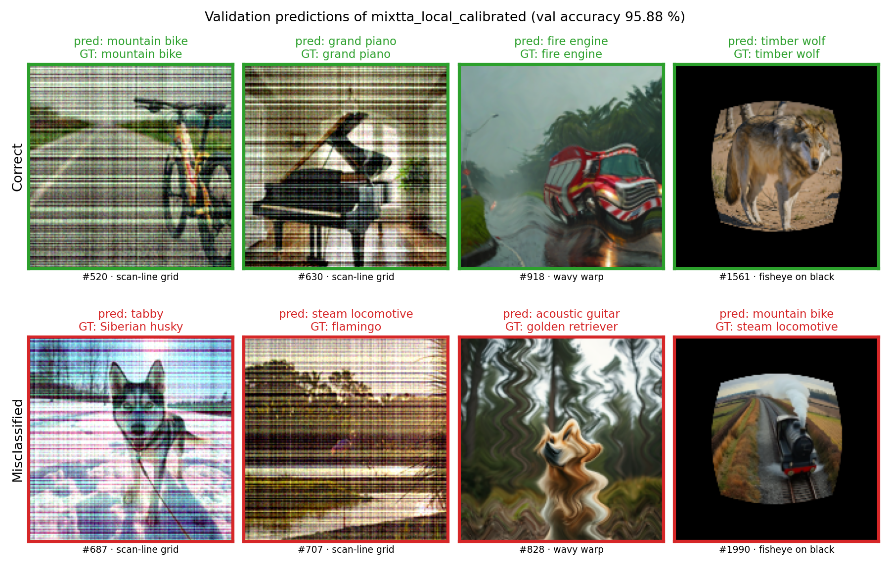

# Practical test-time adaptation

## Q1 Two settings for image classification

### Robust Test-Time Adaptation in Dynamic Scenarios (RoTTA)

- Problem addressed:
  1. continually changing distribution: distribution shift over time
  2. correlative sampling: the data distribution in a batch differs from global distribution
- Method:
  1. Robust Batch Normalization (RBN): instead of using statistics from the current test batch for normalization, they maintain global mean and variance. During adaptation, these statistics are updated using an exponential moving average (EMA) of statistics computed from samples in the memory bank. Since the memory bank maintains a more balanced representation of the data, normalization becomes less sensitive to class imbalance and correlations within the current batch.
  2. Category-balanced Sampling with Timeliness and Uncertainty (CSTU): maintains a memory bank with an equal memory quota for each category. When a new sample arrives, the teacher model predicts its category and uncertainty, and a heuristic score is calculated based on its age and prediction uncertainty. If replacement is needed, RoTTA selects a candidate from either the most populated category or the incoming sample's category. The candidate is replaced only if its heuristic score is higher than that of the new sample. This favors recent, confident samples while maintaining category balance.
  3. Training with timeliness: we first calculate the cross entropy between prediction of teacher model and that of student model (which predicts on strongly augmented samples). Then, the student model updates weights using the loss weighted by timeliness (where newer sample gets larger weight), and the teacher model updates weights using EMA from its own weight and student's weight.
- Pros:
  - Explicitly addresses both continual distribution shifts and non-IID sampling through robust batch normalization and category-balanced memory.
  - Reduces error accumulation using an EMA teacher and timeliness-weighted training.
  - Updates only BN parameters, reducing computational cost and limiting changes to pretrained knowledge.

- Cons:
  - Relies on potentially incorrect pseudo-labels for memory management and self-training.
  - Updating only BN parameters limits adaptation capacity under severe distribution shifts.
  - Slowly updated statistics may struggle with abrupt domain changes, while maintaining a memory bank introduces additional overhead.

### Continual Test-Time Domain Adaptation (CoTTA)

- Problem: error accumulation & catastrophic forgetting of source knowledge
- Method:
  1. Weight-and-augmentation-averaged pseudo-labels: instead of using only final weights, the teacher model uses weights averaged over training steps to generate pseudo-labels. To further reduce error accumulation, they apply augmentation when domain difference is large. Specifically, they approximate domain difference with confidence score, and apply random augmentations when confidence is low to improve the quality of pseudo-labels.

  2. Stochastic Restoration: apply a mask tensor to restore some of the trainable model weight back to the weight of original pre-trained model. This avoid the model to drift too far from the source model. Compared to RoTTA that only updates BN weights, CoTTA updates all trainable weights, bringing more capacity for adaption.

- Pros:
  - Reduces error accumulation through EMA teacher predictions and augmentation averaging.
  - Mitigates catastrophic forgetting through stochastic restoration of pretrained weights.
  - Updates all trainable parameters, providing greater adaptation capacity than BN-only methods.

- Cons:
  - Computationally expensive due to multiple augmented forward passes and full-model parameter updates.
  - Does not explicitly address non-IID or class-imbalanced sampling.
  - Incorrect pseudo-labels can still accumulate errors, while stochastic restoration may interfere with adaptation to the target domain.

## Q2 Method

The latest CSV comes from `mixtta_local_calibrated`. It uses the supplied 20-class ResNet-50 and an online batch size of 64. It retains the preceding batch’s graph probabilities and soft targets, plus one running value per class.

1. **Track the image statistics.** Form two views of each 160-pixel input. For the first, blend every pixel equally with its reflect-padded 3 × 3 neighborhood average, then resize to 192 pixels. Resize the original directly to 256 pixels for the second view. Both use bilinear interpolation. Each size has its own batch-normalization (BN) statistics. Before prediction, update the tracked mean and variance with a fixed rate of 0.4. Mix the updated statistics equally with the source checkpoint’s statistics.
2. **Average views and refine by visual similarity.** At each size, run the original batch, its horizontal flip, and two random flip-and-shift views. Average their probabilities and penultimate features over both sizes. Let $p_i$ be the averaged class probabilities. Soften them with temperature 2 and apply LAME on a five-nearest-neighbor graph of batch features to get $z_i$.
3. **Estimate a local class prior.** For image $i$, count the LAME probabilities from the current and preceding batches. Give a row at stream distance $d$ weight $\exp(-d/12)$, exclude row $i$, and add 0.2 to every class count. Calling the counts $h_i$, the final soft target for class $c$ is proportional to $p_{ic}^{4/3} z_{ic}^{2/3} h_{ic}$. Use this target for self-training and the output rule in Q3.
4. **Adapt for the next batch.** Use the soft targets for three Adam updates at learning rate 0.001. Minimize soft cross-entropy on shifted views from the smoothed 192-pixel branch, updating only the BN scale and bias. The targets come from model predictions. We used validation labels for tuning and scoring.

*For the submitted labels*, we also count nearby training targets and subtract the running background log probability for each class, as defined in Q3.

LAME follows Boudiaf et al., *Parameter-free Online Test-time Adaptation*, CVPR 2022. [Implementation and code attribution](starter/tta/lame.py) · [Local class prior](starter/tta/mixtta_ms.py)

The previous local-prior CSV scored **0.92789** on the public leaderboard, up from 0.91585 for its fixed-tracking baseline. The historical best recorded in the repository is 0.93831. The new submission awaits a Kaggle score. [Previously scored CSV](out/mixtta_local_fixed/test_pred.csv)

The original harness generated 12,288 labels in one test pass after we selected the method on validation. The checker verified the CSV. The shared RTX 5090 recorded 84.5 seconds and 5,374 MiB peak memory. The grading limit is 90 seconds on an RTX 3090, where runtime is unverified. [Official run log](out/mixtta_local_calibrated/test_run_log.json)

## Q3 Strategies and validation results

**Local class prior.** In validation, adjacent images share a class 24.8% of the time. At a separation of 64 images the rate falls to 5.5%. This motivated using nearby predictions to estimate which classes are common around each image. On the same fixed-tracking baseline, the local prior corrected 35 errors and introduced 11. Accuracy rose from **93.99% to 95.12%** (1,985 to 2,009 correct out of 2,112). Both official runs used seed 0.

**Domain shift and self-training.** Mixing the source and tracked BN statistics anchors the model during class-skewed batches. Updating before prediction raised single-scale MixTTA accuracy from 84.66% to 89.06%. Two self-training steps improved on the forward-only version by 1.80 points. The submitted preset combines multi-scale prediction with three updates per batch.

**Method selection.** We developed the local prior on validation using the original stream (seed 0), its reverse (offset 32, seed 1), and domain order 2–0–1 (offset 16, seed 0). The stage-5 version with a shift detector, `mixtta_local`, reached 96.07% on the official validation stream. Its ancestor’s development record says offline test analysis influenced candidate ideas before the val-only re-selection. Under the slide 21 FAQ we used the earlier fixed-tracking baseline for the branch CSV. [Development record](tools/dev/repick.py)

### Validation checks

**Input scale and smoothing.** Increasing both sizes improved official validation by ten images, but lost 44 correct predictions when we recompressed the validation images. Smoothing only the 192-pixel view recovered those losses. The selected preset corrected 32 of the previous preset’s mistakes and introduced 28 on the official stream. The shuffled, JPEG and contrast/noise checks each reuse the 2,112 validation images and informed selection.

| Fixed-tracking preset | Official correct | Shuffled within domain | JPEG quality 35 | Contrast and noise |
|---|---:|---:|---:|---:|
| 160 + 224, previous submission | 2,009 | 1,856 | 1,877 | 1,935 |
| 192 + 256 | 2,019 | 1,886 | 1,833 | 1,918 |
| **192 smoothed + 256** | **2,013** | **1,857** | **1,878** | **1,945** |

We also combined two independently adapting copies of the source model, one at each pair of resolutions. Averaging their log probabilities reached 95.60% on official validation. The single smoothed model averaged 94.69% on the three screening configurations above, versus 94.48% for the ensemble, and used three gradient updates per batch versus six.

Each control uses adaptation seed 0. The within-domain permutation uses NumPy seed 17. The photometric control applies random per-image contrast in [0.55, 1.20] and Gaussian noise with standard deviation 0.04 on a 0–1 pixel scale, using seed 113. [Control code](tools/dev/val_controls.py) · [Correct counts](out/mixtta_local_smooth192/val_controls.json)

Across seven orders, four offsets and two seeds (56 validation runs), mean accuracy rose from **93.92% to 94.84%**. Each of the seven order averages improved. On the continuous 231-batch stream, the smoothed preset scored 95.45% on the first 2,112 images and 98.30% on the last 2,112. The most frequent predicted class accounted for 5.26% of the final window, passing the collapse check. [Previous protocol](out/mixtta_local_fixed/val_protocol.json) · [New protocol](out/mixtta_local_smooth192/val_protocol.json)

### Prediction from nearby self-training targets and class calibration

The smoothed model supplies an image probability $p_i$, a graph probability $z_i$ and a soft training target $t_i$. For prediction we estimated a second class prior from nearby **training targets**, with distance weights $\exp(-d/8)$ and 0.2 added to each class count. As in Q2, we excluded the query row and used the current and previous batches. The intermediate rule scored classes by $0.75\log p_i + 0.25\log z_i + 0.5\log a_i$, where $a_i$ is the new count vector. The self-training loss still uses $t_i$.

**Class calibration.** For each class, we measured its mean log image probability on current rows whose most likely training target was another class. We initialized this value from the first batch and updated it with an exponential moving average at rate 0.15. We subtracted the running value from that class’s output score before taking the argmax. If a class had no eligible rows, we retained its previous value or used the mean of the other available classes at initialization.

| Output rule | Official correct | 56-run mean | Shuffle | JPEG | Contrast/noise |
|---|---:|---:|---:|---:|---:|
| Smoothed model | 2,013 | 94.84% | 1,857 | 1,878 | 1,945 |
| Nearby training targets | 2,023 | 95.03% | 1,860 | 1,884 | 1,948 |
| **Nearby targets + class calibration** | **2,025** | **95.22%** | **1,869** | **1,890** | **1,951** |

The official validation counts come from end-to-end runs. For the longer protocol we replayed the model’s chronological validation outputs through each prediction rule, starting with empty state for every run. We checked the replay against every official validation prediction. The calibrated rule scored 96.07% in the first window and 98.25% in the final window of the 231-batch run. The largest final class share was 5.26%. [Intermediate protocol](out/mixtta_local_readout/val_protocol.json) · [Calibrated protocol](out/mixtta_local_calibrated/val_protocol.json) · [Controls](out/mixtta_local_calibrated/val_controls.json)

As a separate check after choosing the settings, we reduced the validation images to 96 pixels with antialiased bilinear interpolation, then enlarged them back to 160 pixels. The smoothed model got 1,950 correct, nearby targets alone got 1,949, and class calibration got 1,961. [Reduced-resolution results](out/mixtta_local_calibrated/val_low_resolution.json)

**Earlier stage-wise sweep.** A separate 56-run study evaluated self-training, a shift detector, in-batch domain splitting, an extra prediction pass, a cumulative class prior, layer-specific learning rates, and an adaptive temperature. Their successive selected means were 93.12%, 93.52%, 93.91%, 93.91%, 93.91%, 94.16% and 94.16%. Within 0.3 points of the best passing setting, the sweep preferred the simplest option. The submitted preset uses fixed BN tracking. [Stage-by-stage table](https://github.com/r14944045/CV_hw2/blob/65b3496/report.md#earlier-stage-wise-validation-sweep) · [Archived scores](out/val_exp/repick_final.json)

### Method comparisons

Each value is top-1 accuracy on the official validation stream. The full per-method predictions and official logs are under [out/](out/).

| Strategy | Validation accuracy (%) |
|:-----------------------------------------|:-----------------------------------------|
| Frozen source model | 54.55 |
| Normalization alone | Current batch 72.16, Robust BN 76.23 |
| RoTTA | Full 65.01, current-batch BN 72.30, remove memory 72.92, remove timeliness 64.96 |
| CoTTA | Full 76.99, four augmentations 73.30, remove augmentation averaging 72.16, remove restoration 77.60, Robust BN 59.42 |
| BOSA | Full 60.70, remove memory 77.51, remove alignment 64.68, remove constraint 58.62, remove sparsification 60.56, entropy loss 59.19 |
| Single-scale MixTTA | Full 89.06, previous batch’s statistics 84.66, remove LAME 86.41, remove augmented views 86.93, mixed statistics alone 83.19 |
| BN ablations with MixTTA | Frozen source 55.82, current batch 80.68, robust batch statistics 82.24, fast tracking with zero source weight 86.51 |
| Self-training MixTTA at 160 px | Forward only 90.10, one update 91.15, two updates 91.90 |
| Multi-scale MixTTA with fixed tracking | Baseline 93.99, local prior 95.12, larger views with smoothing 95.31, **calibrated output 95.88** |
| Multi-scale MixTTA with shift detection | Stage 5 baseline 94.74, local prior 96.07 |

## Q4 Validation examples

The top row shows four correct predictions and the bottom row shows four errors. Each image carries its predicted class, ground truth, stream position, and validation domain. We sampled with seed 0, taking one example per domain and a second scan-line example in each row.

| Validation domain | Images | Errors with smoothed model | Errors with calibrated model |
|---|---:|---:|---:|
| Scan-line grid | 776 | 36 | 29 |
| Wavy warp | 724 | 40 | 38 |
| Fisheye | 612 | 23 | 20 |
| **All** | **2,112** | **99** | **87** |

The new method reduced errors in all three domains. The largest gain was seven images in the scan-line domain. The model recognized the fire engine under wavy distortion (#918), but labeled the golden retriever in the same domain an acoustic guitar (#828). In the fisheye domain it recognized the timber wolf (#1561) and mistook the steam locomotive for a mountain bike (#1990). Regenerate the figure with `python tools/plot_val_examples.py --method mixtta_local_calibrated`.
